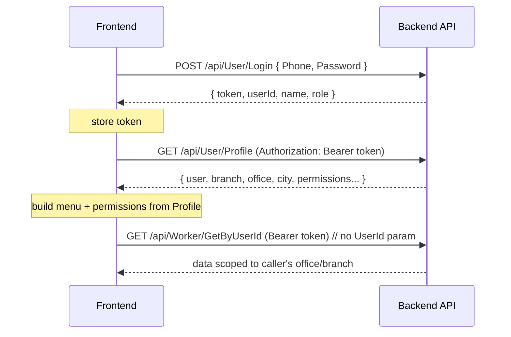

# Frontend Migration Guide — FanAlFaisal Auth & Security (Phase 1–3)

**Audience:** Frontend developers. Self-contained — you do not need to read backend code.
**Date:** 2026-06-15
**Backend base route:** `/api/...` (controllers under area `api`).

---

## 1) Summary of Breaking Changes

1. **API key moved to header.** `POST /api/Authentication/Login?Key=XXXX` → now `X-Api-Key: XXXX` header. Sending `?Key=` returns **400 Bad Request**.
2. **Login response changed.** `User/Login` now returns a small `LoginResponseDto` (`token, userId, name, role`) — nothing else.
3. **Profile data removed from login.** `Branch`, `Office`, `City`, `TaxNumber`, `CRNumber`, `Logo`, `Permissions`, `OrdersCount` are **no longer** in the login response. Fetch them from `GET /api/User/Profile`.
4. **JWT claims reduced** to `sub` (= userId) and `role` only. `name`, `phone`, `email`, `roles` (plural), and any business data are gone from the token.
5. **`UserId` / `OfficeId` / `BranchId` must no longer be sent** by the frontend to the converted endpoints — the backend derives them from the JWT. Several endpoint signatures changed (params removed or ignored).
6. **Per-user token is now mandatory.** Protected/data endpoints derive identity from the `sub` of the **User/Login** token. The old shared service token (from Authentication/Login) will be rejected by Phase 2/3 endpoints (its `sub` is not a real user id).
7. **Role claim renamed** `roles` → `role` (singular). Role values: `Admin`, `Supervisor`, `User` (staff), `Client` (mobile).
8. **Auth responses are now `no-store`** and **rate-limited 5/min/IP** (HTTP 429 on excess).

---

## 2) Authentication Flow — Before vs After

### Previous flow
```
POST /api/Authentication/Login?Key=XXXX  (Phone/Pass in body)   → JWT (shared service account)
POST /api/User/Login (Phone, Password)   → { user, branch, office, taxNumber, crNumber, permissions, ... }
Frontend builds menu/permissions from the User/Login response.
Subsequent calls send UserId / OfficeId per request.
```

### New flow
```
POST /api/User/Login (Phone, Password)
   ↓ Receive: { token, userId, name, role }
   ↓ Store token (and userId/name/role for quick UI)
   ↓ GET /api/User/Profile      (Authorization: Bearer <token>)
   ↓ Load: User + Branch + Office + Company Data + Permissions
   ↓ Build menu / permissions FROM Profile (not from login, not from JWT)
Subsequent calls: send Authorization: Bearer <token> only — no UserId/OfficeId.
```

### Sequence diagram


ASCII fallback:
```
Login → Receive Token → Store Token → GET /api/User/Profile → Load User/Branch/Office/Permissions
```

---

## 3) Login API Contract

### Request
```
POST /api/User/Login?Lang=ar&FromOffice=false
Content-Type: application/json

{ "phone": "+9665XXXXXXXX", "password": "••••••" }
```
- `User/Login` is now `[AllowAnonymous]` (no token needed to call it) and rate-limited (5/min/IP).

### Response (`ResponseModel` wrapping `LoginResponseDto`)
```json
{
  "success": 1,
  "message": "Success",
  "data": {
    "token": "<JWT>",
    "userId": "f0e9...-guid",
    "name": "Mohammed",
    "role": "Admin"
  }
}
```
- `success`: 1 = ok, 0 = failure (e.g. wrong credentials → message `CheckLoginData`).
- `data` contains **only** these 4 fields. No company/branch/office/permissions.

### Authentication/Login (API-key bootstrap — only if you still use it)
```
POST /api/Authentication/Login
X-Api-Key: <APIKEY>
Content-Type: application/json
{ "name": "...", "pass": "..." }
```
- `?Key=...` in the query → **400 Bad Request**.
- Response `data`: `{ "token": "<JWT>" }`.

---

## 4) User Profile API Contract

```
GET /api/User/Profile?Lang=ar
Authorization: Bearer <token from User/Login>
```
**Authorization required.** Identity is taken from the token's `sub` — you cannot request another user's profile.

### Response (`ResponseModel` wrapping `UserModel`)
```json
{
  "success": 1,
  "message": "Success",
  "data": {
    "id": "guid",
    "name": "Mohammed",
    "phone": "+9665...",
    "email": "...",
    "admin": true,
    "supervisor": false,
    "active": true,
    "branchId": "guid",
    "cityId": "guid",
    "branch": {
      "id": "guid", "nameAr": "...", "nameEn": "...",
      "office": { "id": "guid", "nameAr": "...", "taxNumber": "...", "crNumber": "...", "logo": "...", "address": "..." }
    },
    "city": { "id": "guid", "nameAr": "...", "nameEn": "..." },
    "ordersCount": 0,
    "createdDate": "..."
  }
}
```
> Company/tax/CR/logo live under `data.branch.office`. Load **permissions** from `GET /api/UserPrivilege/GetByUserId` (no params — derived from token).

---

## 5) JWT Changes

### Old claims
```json
{ "jti": "...", "unique_name/name": "Admin", "roles": "Admin" }
```
(client token also had `name` = phone.)

### New claims
```json
{ "jti": "...", "sub": "<userId-guid>", "role": "Admin" }
```

**Stop reading from the JWT:** `name`, `phone`, `email`, `roles` (plural), `office`, `branch`, or any business data.
**Only guaranteed:** `sub` (user/client id) and `role`.
- Get display name/branch/office from **Profile**, not the token.
- Role checks: read `role` (singular). Values: `Admin` / `Supervisor` / `User` / `Client`.
- If you decode JWT client-side: `sub` is the id; the inbound claim is literally named `sub` and `role` (backend disabled claim-type remapping).

---

## 6) API Key Migration

| Old | New |
|-----|-----|
| `POST /api/Authentication/Login?Key=xxxxx` | `POST /api/Authentication/Login` + header `X-Api-Key: xxxxx` |

- Remove **every** `?Key=` usage. Any request still sending it to Authentication/Login → **400**.
- Only `Authentication/Login` uses `X-Api-Key`. All other endpoints use `Authorization: Bearer`.

**Files to update (search patterns):**
```
grep -rn "Key=" src/            # query-string api key usage
grep -rni "x-api-key\|apikey\|APIKEY" src/
grep -rn "Authentication/Login" src/
```
Typically: the auth/login service, the HTTP client/interceptor that builds requests, and any environment/config file holding the key.

---

## 7) Removed Request Parameters (stop sending)

Backend now derives identity from JWT. Stop sending the listed params:

| Endpoint | Stop sending |
|----------|--------------|
| `GET /api/Client/GetByUserId` | `UserId` |
| `GET /api/Client/GetByOfficeId` | `OfficeId` |
| `GET /api/Notification/GetAll` | `UserId` |
| `GET /api/Notification/GetByUserId` | `UserId` |
| `POST /api/Notification/MarkAsRead` | `UserId`, `ClientId` (keep `Id`) |
| `GET /api/Home/GetHomeInformation` | `UserId` |
| `GET /api/UserPrivilege/GetByUserId` | `UserId` |
| `GET /api/Worker/GetByUserId` | `UserId` |
| `GET /api/Worker/GetAll` | `OfficeId` |
| `POST /api/Order/Approve` | `UserId` |
| `GET /api/Order/GetAll` | `OfficeId` |
| `GET /api/Branch/GetAll` | `OfficeId` |
| `GET /api/Shelter/GetAll` | `OfficeId` |
| `GET /api/ShelterEntry/GetAll` | `OfficeId` |
| `GET /api/DeliveryZone/GetAll` | `OfficeId` |
| `GET /api/Invoice/GetAll` | `OfficeId` |
| `GET /api/Payment/GetAll` | `OfficeId` |
| `GET /api/Report/GetAll` (GetWorkers) | `OfficeId` |
| `GET /api/Offer/GetAll` | `OfficeId` |
| `GET /api/Linking/GetByOfficeId`/`GetChartOfAccounts`/`GetTaxTypes`/`GetCostCenters` | `OfficeId` |
| `POST /api/Worker/Import` | `OfficeId` |
| `POST /api/Worker/ImportFromExcel` | `UserId`, `OfficeId` |
| `POST /api/Worker/Import1` | `OfficeId` |
| `POST /api/Worker/ImportFromExcel1` | `UserId`, `OfficeId` |

> `BranchId` is still accepted as an optional **filter** on some list endpoints (e.g. Worker/Order), but the result is always restricted to your own office. Do not rely on `BranchId`/`OfficeId` to widen scope.

---

## 8) Endpoint Signature Changes (Phase 1–3)

| Endpoint | Old Parameters | New Parameters | Frontend Action |
|----------|----------------|----------------|-----------------|
| `Authentication/Login` | `?Key=`, body | header `X-Api-Key`, body | Move key to header; handle 400 |
| `User/Login` | body → full user+company | body → `{token,userId,name,role}` | Read 4 fields; then call Profile |
| `User/Profile` (new) | — | `Lang`, Bearer | Implement profile load |
| `Client/GetByUserId` | `UserId` | (none) | Drop `UserId` |
| `Client/GetByOfficeId` | `OfficeId` | `OfficeId` ignored | Drop `OfficeId` |
| `Notification/GetAll` | `UserId` | (none) | Drop `UserId` |
| `Notification/GetByUserId` | `UserId` | (none) | Drop `UserId` |
| `Notification/MarkAsRead` | `Id,UserId,ClientId` | `Id` | Send only `Id` |
| `Home/GetHomeInformation` | `UserId,Paid` | `Paid` | Drop `UserId` |
| `UserPrivilege/GetByUserId` | `UserId` | (none) | Drop `UserId` |
| `Worker/GetByUserId` | `UserId,...filters` | `...filters` | Drop `UserId` |
| `Worker/GetAll` | `...,OfficeId,...` | `OfficeId` ignored | Drop `OfficeId` |
| `Order/Approve` | `Id,UserId` | `Id` | Drop `UserId` |
| `Order/GetAll` | needs `OfficeId/...` | `OfficeId` ignored | Drop `OfficeId`; no "missing filter" needed |
| `Branch/GetAll` | `OfficeId` | `OfficeId` ignored | Drop `OfficeId` |
| `Shelter/GetAll` | `OfficeId` | ignored | Drop |
| `Shelter/GetByBranchId` | `BranchId` | `BranchId` (own office only) | Keep, scoped |
| `DeliveryZone/GetAll` | `OfficeId` | ignored | Drop |
| `DeliveryZone/GetByBranchId` | `BranchId` | own office only | Keep, scoped |
| `ShelterEntry/GetAll` | `OfficeId,...` | `OfficeId` ignored | Drop `OfficeId` |
| `Invoice/GetAll` | `OfficeId,...` | ignored | Drop `OfficeId` |
| `Invoice/GetById` | `Id` | `Id` (own office only) | No change; expect "not found" for other office |
| `Payment/GetAll` | `OfficeId,...` | ignored | Drop `OfficeId` |
| `Report/GetAll` | `OfficeId,...` | ignored | Drop `OfficeId` |
| `Offer/GetAll` | `OfficeId,BranchId` | `OfficeId` ignored | Drop `OfficeId` |
| `Linking/GetByOfficeId` + `GetChartOfAccounts`/`GetTaxTypes`/`GetCostCenters` | `OfficeId` | ignored | Drop `OfficeId` |
| `Worker/Import` | `OfficeId,workers` | `workers` | Drop `OfficeId` |
| `Worker/ImportFromExcel` | `UserId,OfficeId,File` | `File` | Drop `UserId,OfficeId` |
| `Worker/Import1` | `OfficeId,workers` | `workers` | Drop `OfficeId` |
| `Worker/ImportFromExcel1` | `UserId,OfficeId,File` | `File` | Drop `UserId,OfficeId` |

> Payment-gateway endpoints (`Fatoorah/InitiatePayment`, `Urway/*`) are **unchanged for now** (QA-gated). No frontend action yet.

---

## 9) Potential Runtime Errors (if migration incomplete)

| Symptom | Cause |
|---------|-------|
| **400 Bad Request** on login | Still sending `?Key=` instead of `X-Api-Key` header |
| **401 Unauthorized** on data calls | Using old/shared token, or missing `Authorization: Bearer` |
| **403 / empty results** | Sending another scope's `OfficeId`/`UserId`; backend ignores it and scopes to your office |
| **Missing Profile Data** (undefined office/branch/tax) | Reading company data from login response instead of `GET /api/User/Profile` |
| **Empty Permissions / broken menu** | Permissions were built from login response or JWT `roles`; must load from Profile / `UserPrivilege` |
| **Failed Login / blank user** | Reading `data.user`/`data.office` that no longer exist; read `data.token/userId/name/role` |
| **Role guards fail** | Reading JWT `roles` (plural) / `name`; read `role` (singular) or Profile |
| **429 Too Many Requests** | More than 5 login attempts/min/IP; show a friendly retry message |
| **All users logged out after deploy** | Old tokens (claims `roles`/`name`) invalid for role checks — force re-login |

---

## 10) Migration Checklist

```
[ ] API Key migrated to X-Api-Key header (all ?Key= removed)
[ ] Login response handling updated (token, userId, name, role only)
[ ] GET /api/User/Profile implemented and called after login
[ ] Company/branch/office data read from Profile (not login, not JWT)
[ ] JWT handling updated (read sub + role only; stop reading name/phone/roles)
[ ] UserId removed from all requests
[ ] OfficeId removed from all requests
[ ] BranchId no longer used to widen scope
[ ] Permissions loading updated (from Profile / UserPrivilege)
[ ] Bearer token attached to every protected request (per-user token)
[ ] 400 / 401 / 429 handled in HTTP interceptor
[ ] Forced re-login on deploy (old tokens invalidated)
[ ] QA completed (login, profile load, role guards, scoped lists)
```

---

## 11) Affected Frontend Files

> The frontend repository is **not connected** to this workspace, so exact paths cannot be enumerated here. Below are the components to change plus ready-to-run search commands to locate the actual files in your repo (Vite app — React/Vue — served at `localhost:5173`).

| Component | What changes | How to find it |
|-----------|--------------|----------------|
| **Auth / Login service** | Read `{token,userId,name,role}`; call Profile; store token | `grep -rn "User/Login\|Authentication/Login" src/` |
| **HTTP interceptor (request)** | Add `Authorization: Bearer`; add `X-Api-Key` only to Authentication/Login; remove `?Key=` | `grep -rni "interceptor\|axios.create\|HttpClient\|fetch(" src/` |
| **HTTP interceptor (response)** | Handle 400 (key in query), 401, 429 | same files as above |
| **Route guards** | Read `role` (singular) / Profile, not `roles` | `grep -rni "guard\|canActivate\|requireAuth\|ProtectedRoute" src/` |
| **Login component(s)** | Stop reading `data.user/office/branch`; read new DTO | `grep -rni "login" src/ --include=*.vue --include=*.tsx --include=*.jsx` |
| **User context / store** | Store token + profile separately; derive role from Profile/role claim | `grep -rni "useAuth\|AuthContext\|userStore\|currentUser\|Vuex\|pinia\|redux" src/` |
| **Permission service** | Load from Profile / `UserPrivilege/GetByUserId` (no params) | `grep -rni "permission\|privilege\|UserPrivilege" src/` |
| **Storage helpers** | Store `token`; cache profile; clear on logout | `grep -rni "localStorage\|sessionStorage\|setItem\|getItem" src/` |
| **Sidebar / menu** | Build from Profile, not login response | `grep -rni "sidebar\|menu\|nav" src/` |
| **JWT decode util** | Use `sub`/`role` only | `grep -rni "jwt\|jwtDecode\|decode(" src/` |
| **Any data service sending IDs** | Remove `UserId`/`OfficeId` (see §7) | `grep -rniE "UserId|OfficeId" src/` |

**To produce exact paths:** connect/clone the frontend repo and run the commands above; I can then generate a precise file list and diffs.

---

### References (backend, this repo)
`SECURITY_AUDIT.md` (Phase 1) · `SECURITY_AUDIT_PHASE2.md` · `SECURITY_AUDIT_PHASE3.md` · `SECURITY_QA_PENTEST.md` · `SECURITY_CLOSURE_REPORT.md`
